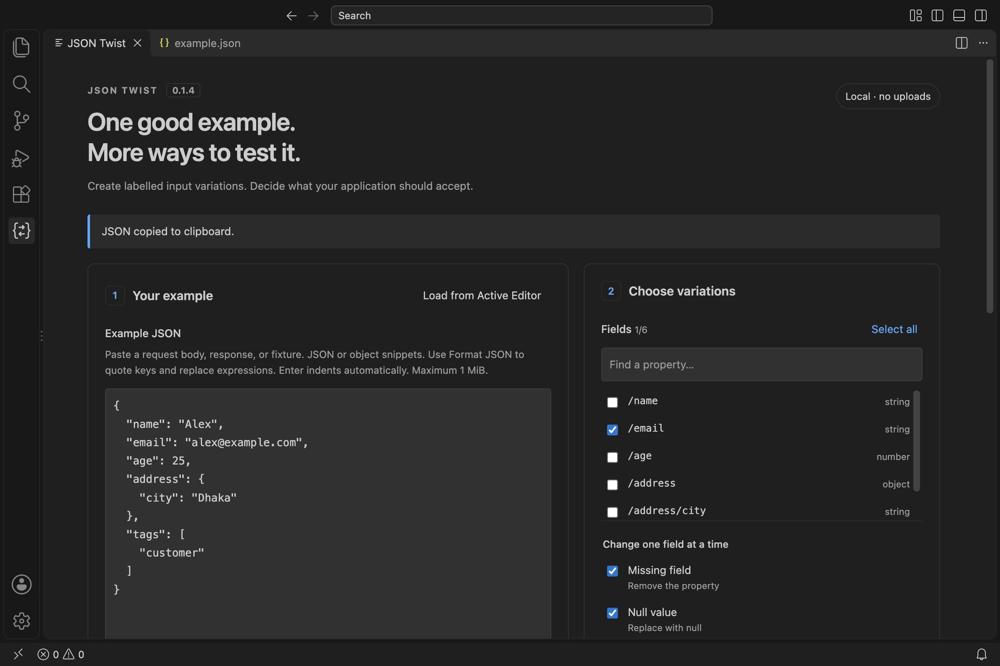

# JSON Twist - Edge Case Generator

Turn a working JSON example into labelled **missing**, **null**, **empty**, and **wrong-type** input fixtures, directly in VS Code.

Version 0.1.4 is a local release candidate. It is not published to the Marketplace. The manifest uses `local-development` until the owner supplies a verified publisher ID and public repository URL.

## Why use it?

You already have a working request body, response, or fixture. Instead of manually editing it repeatedly, choose fields and generate independent copies. Each case changes one property, leaving the other baseline values alone.

For example, `{ "email": "alex@example.com", "age": 25 }` can produce:

```json
{ "age": 25 }
```

```json
{ "email": null, "age": 25 }
```

```json
{ "email": "", "age": 25 }
```

```json
{ "email": 123, "age": 25 }
```

These are **candidate inputs**, not test verdicts. Your application may legitimately accept some of them. Use your API client, mocks, or automated tests to check behavior.

## Real VS Code preview



[See the generated JSON results](docs/images/vscode-results.png). These are actual captures of the installed VSIX using synthetic data.

## Install the local release

1. Build the VSIX with the development instructions below, or obtain the supplied `json-edge-case-maker-0.1.4.vsix`.
2. In VS Code, run **Extensions: Install from VSIX…** and select it.
3. Run **JSON Twist: Open** from the Command Palette.

Requires VS Code desktop 1.100.0 or newer. No API key, account, backend, or project dependencies are required by the installed extension.

## Activity Bar access

Click the braces/arrows **JSON Twist** icon on VS Code's Activity Bar to open the entire generator directly in the right-hand editor panel. There is no extra Open Generator button. Clicking the icon again reveals the existing generator and preserves its input and generated files.

Generated files, previews and Copy JSON all remain inside that editor panel. If the icon is hidden, right-click the Activity Bar and enable **JSON Twist**. Command Palette access still works. [See the one-click result](docs/images/vscode-activity-launch.png).

To customize the icon or understand the manifest/launcher wiring, read [Activity Bar launching](docs/learning/07-activity-bar-and-sidebar.md).

## Workflow

1. Copy JSON from an API request, response, or fixture. Paste it into the panel; no file is required. Alternatively, open a JSON document and use the editor context menu.
2. Select properties. Nested object properties appear as selectable paths; arrays are treated as single values.
3. Choose variations and click **Generate edge cases**.
4. The panel brings **Generated JSON files** into view. Click a filename such as `002-null.json` to see its formatted JSON and explanation.
5. **Copy JSON** copies the file you are viewing. Use Up/Down, Home/End to browse the file list with a keyboard.

Generated files are virtual, memory-only previews inside the extension. Generating, opening and copying them creates no folders or files on disk. Closing the panel clears them. If you want saved copies, expand **Save files to disk (optional)**, check files and choose **Export selected**.

**Load from Active Editor** uses the last active text editor while the panel has focus. A text selection is used first; otherwise the entire JSON/JSONC document is loaded. Editor imports are converted to strict JSON before generation. Unquoted keys, single quotes, comments and trailing commas in object snippets are accepted by this import step. Source documents are never edited.

### Object snippets and editing

Select an object or a comma-separated property list in any editor, then choose **Load from Active Editor**. The panel adds braces, quotes keys, removes trailing commas, preserves literal values and nested structures, and uses two-space formatting. JavaScript variable expressions and shorthand values become empty strings without executing code:

```js
supplierId,
supplierName: supplier?.supplierName,
warehouseId,
warehouseName: warehouse?.name,
```

becomes:

```json
{
  "supplierId": "",
  "supplierName": "",
  "warehouseId": "",
  "warehouseName": ""
}
```

The import note reports how many runtime expressions were replaced. Select the object/properties themselves, not a whole variable declaration or function. Computed keys, spreads, object methods/getters, array holes and BigInt literals are rejected rather than silently losing data.

For snippets pasted directly into the panel, click **Format JSON**. While typing, **Enter** carries indentation and adds two spaces after an opening brace/bracket. Between adjacent `{}` or `[]`, it creates an indented blank line. Tab remains available for keyboard focus navigation; full formatting is explicit so incomplete edits and the caret are preserved.

**Fill dummy values** first converts the snippet, then fills only empty strings and nulls using deterministic property-name hints. For example, `supplierId` becomes `1`, `supplierName` becomes `"Example Supplier"`, `openingQty` becomes `10`, and `batchNumber` becomes `"BATCH-001"`. Existing non-empty values, numbers, booleans and empty collections are preserved. These are editable examples, not schema-aware type inference. Review them before generating edge cases.

Changing input or variation selections disables copy/export until you generate again. Field search and export-checkbox changes do not change the generation configuration.

### Paths and supported mutations

Paths use [JSON Pointer](https://www.rfc-editor.org/rfc/rfc6901), not JavaScript dot notation. `/address/city` selects a nested property. A literal slash in a key becomes `~1`, and a literal tilde becomes `~0`. `/` selects an empty-string property name. Array contents are not listed.

| Variation     | Behavior                                                                                                                      |
| ------------- | ----------------------------------------------------------------------------------------------------------------------------- |
| Missing field | Remove the selected property.                                                                                                 |
| Null value    | Replace it with `null`. Already-null properties are skipped.                                                                  |
| Empty value   | Strings → `""`, arrays → `[]`, objects → `{}`. Other types and already-empty values are skipped.                              |
| Wrong type    | Strings → `123`; numbers → `"not-a-number"`; booleans → `"not-a-boolean"`; objects → `[]`; arrays → `{}`; null → `"example"`. |

Results follow source field order and the variation order above. Identical resulting payloads are deduplicated. Each case is generated from the original baseline, including when both a parent and its child are selected.

### Optional disk export

Expand **Save files to disk (optional)** to reveal export selection checkboxes and controls. Choose a local parent directory. Export creates a separate uniquely named `json-edge-cases-...` folder containing numbered fixtures and `index.json` with filenames, JSON Pointer paths, mutations, and explanations. It never overwrites an existing file. On a write failure, the report lists completed files and the failed filename; completed files are retained for inspection.

Exported filenames match those in the panel, even when exporting a subset; numbering may contain gaps. The index is metadata, not an additional fixture. The original baseline is not exported automatically.

## Limits and privacy

- Generation requires a strict JSON object at the root, without comments, trailing commas or duplicate decoded property names. Editor import and Format JSON explicitly convert supported object snippets first; raw typing is still validated as strict JSON.
- Maximum input: 1 MiB UTF-8; maximum depth: 32 edges below the root; combined field paths: 2 MiB; maximum output: 250 cases and 16 MiB total generated JSON. Exceeding limits fails the generation rather than truncating it.
- Non-finite numbers and integers outside JavaScript's safe range are rejected to prevent silently changed fixtures. Encode large identifiers as strings. Ordinary decimal numbers use JavaScript number semantics; this is not an arbitrary-precision JSON editor.
- Generic mutations only. There are no schema/business rules, array-item targeting, function execution, HTTP requests, or automated validity assertions.
- Export supports local folders only. Browser-hosted VS Code and virtual workspaces are outside version 0.1's support scope. Remote development has not been validated.
- The extension has no network calls, telemetry, or payload history. Input and results live in memory while the panel is open. Switching tabs retains them; closing the panel releases the session. Clipboard and exported files persist at the user's explicit request. VS Code/OS clipboard behavior is outside the extension's control.
- The panel works in Restricted Mode because it only transforms supplied JSON; it never runs project code.

## Development quick start

Use Node.js 22.14+ or 24 LTS and npm. The checked-in lockfile makes dependency installation reproducible. Some development dependencies include native publishing helpers; ordinary compilation and VSIX packaging do not need signing or keychain access.

```sh
npm ci
npm run compile
```

Open this folder in VS Code and press **F5**. A separate **Extension Development Host** window opens. In that window run **JSON Twist: Open**. Make a source change, compile again, then run **Developer: Reload Window** in the development host.

```sh
npm run check             # type checks, lint, formatting, unit tests
npm run test:integration  # official VS Code extension-host tests
npx playwright install chromium
npm run test:ui           # real panel + engine through a test transport
npm run package          # artifacts/json-edge-case-maker-0.1.4.vsix
npm run test:package      # installs that exact VSIX in an isolated profile and tests it
npm run release:check     # intentionally fails until release identity/URLs are supplied
```

`test:integration` downloads VS Code Stable unless `VSCODE_EXECUTABLE_PATH` points to its executable. `test:ui` accepts `CHROME_PATH` for an existing Chrome executable. Test downloads and the local UI test server are development-only. Scripts use temporary VS Code profiles rather than modifying your regular setup. `watch` recompiles extension-host TypeScript only; run `compile` after webview/CSS/HTML changes.

Start learning with [Extension basics](docs/learning/01-extension-basics.md), then follow the numbered [learning guide](docs/learning/02-project-walkthrough.md). See [CONTRIBUTING](CONTRIBUTING.md) for code conventions and [release preparation](docs/learning/06-packaging-and-publishing.md) before publishing.

The public display name is **JSON Twist - Edge Case Generator**. The existing `json-edge-case-maker` package identity and `jsonEdgeCaseMaker.open` command ID remain stable for local upgrades; the visible command is **JSON Twist: Open**.

## License

MIT. See [LICENSE](LICENSE).
