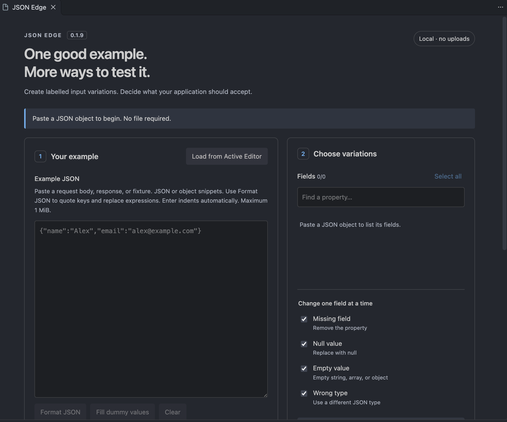
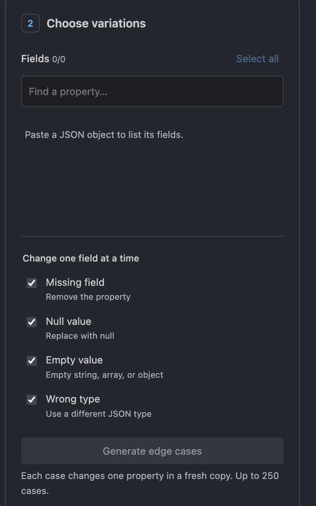
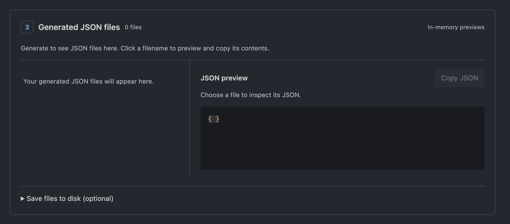

# JSON Edge - The Edge Case Maker

Turn one JSON example into labelled **missing**, **null**, **empty**, and **wrong-type** inputs in VS Code. Preview each generated file and copy its JSON without leaving the editor.


**[▶ Watch the JSON Edge demo video](https://github.com/masum2617/json-edge/blob/main/docs/media/jsonedgedemo.mp4)** · [User guide](docs/USER-GUIDE.md) · [Report an issue](https://github.com/masum2617/json-edge/issues)

## What it does

- Generates independent variations: each file changes exactly one property in a fresh copy of your example.
- Supports nested object fields and treats arrays as complete values.
- Shows a clickable list of virtual JSON files, with explanations and **Copy JSON**.
- Converts selected JavaScript object snippets into JSON without executing code.
- Provides **Format JSON**, indentation on Enter, optional **Fill dummy values**, and **Clear**.
- Offers optional disk export when you want saved fixtures.
- Works locally with no API key, account, backend, telemetry, or network requests from the extension.

These are candidate inputs, not test verdicts. Your application decides whether each case should be accepted.

## Quick start

1. Open a JSON document, or copy an example from an API request or fixture.
2. Click the **JSON Edge** braces/arrows icon in the Activity Bar, or run **JSON Edge: Open**.
3. Select fields and variations, then click **Generate edge cases**.
4. Click a filename such as `002-null.json` to inspect it.
5. Click **Copy JSON** and use the payload in your API client or existing tests.

Clicking the Activity Bar icon again closes the generator and clears its session; click again to reopen. **JSON Edge: Open** reveals an existing panel without closing it. **Clear**, beside **Fill dummy values**, resets panel input and results without editing your source document.

Generated files stay in the panel's memory. Generating, previewing and copying do not create folders. To save copies, expand **Save files to disk (optional)**. Closing the panel clears the session.



[View all three screenshots](docs/images/README.md)

## Example

Starting with:

```json
{ "name": "Alex", "email": "alex@example.com", "age": 25 }
```

Selecting `/email` produces these alternatives, with the other properties preserved:

| Variation  | Change          |
| ---------- | --------------- |
| Missing    | Remove `email`  |
| Null       | `"email": null` |
| Empty      | `"email": ""`   |
| Wrong type | `"email": 123`  |





Nested fields use JSON Pointer paths, such as `/address/city`. Keys containing dots, slashes or tildes remain distinguishable. Results are deterministic; unchanged and duplicate outputs are skipped.

## Object snippets

Select an object or a list of properties in an editor and choose **Load from Active Editor**. For pasted snippets, use **Format JSON**.

```js
userId,
name: profile?.name,
email: profile?.email,
isActive,
```

becomes:

```json
{
  "userId": "",
  "name": "",
  "email": "",
  "isActive": ""
}
```

Unquoted keys, single quotes and trailing commas are normalized. Literal values are preserved; runtime expressions become empty strings, with a note explaining the substitutions. No project code is executed. **Fill dummy values** optionally fills empty strings/nulls using field-name hints; review these inferred values and types before generating.

## Installation and support

Requires VS Code **desktop 1.100.0 or newer**. For manual installation, build or obtain the VSIX and use **Extensions: Install from VSIX…**.

After installation, run **Developer: Reload Window** if upgrading a local build. If the icon is hidden, right-click the Activity Bar and enable **JSON Edge**. [Detailed installation and troubleshooting](docs/USER-GUIDE.md).

## Limits and privacy

- Generation requires a strict JSON **object** at the root. Use the explicit import/format step for object snippets.
- No duplicate keys. Maximum input: **1 MiB**; depth: **32**; output: **250 cases / 16 MiB**. Exceeded limits produce an error instead of truncating results.
- Arrays are mutated as whole values. JSON Schema/OpenAPI import, business-rule generation, function execution and HTTP testing are outside this release.
- Unsafe integers/non-finite numbers are rejected. Ordinary decimal values follow JavaScript number semantics.
- Desktop/local export is supported. Browser-hosted VS Code, relocated launcher views, and remote development are outside the verified scope.
- Input/results live in memory until the panel closes. Copied text and exported files persist at your request. [Privacy details](docs/PRIVACY.md).

## Development and documentation

```sh
npm ci
npm run compile
npm run check
```

Open the project in VS Code and press **F5**. See the [development guide](docs/DEVELOPMENT.md) for all test, debugging, packaging and demo-recording commands.

- [User guide](docs/USER-GUIDE.md)
- [Learning chapters](docs/learning/01-extension-basics.md)
- [Contributing](CONTRIBUTING.md)
- [Changelog](CHANGELOG.md)
- [Step-by-step Marketplace publishing](docs/PUBLISHING.md)

MIT licensed. See [LICENSE](LICENSE).
